<div align="center">

# 🦷 Northgate Dental

### *From phone queue to booked patient — in under 60 seconds*

> A trust-first dental clinic website with transparent published fees, treatment explainers written for anxious patients, and a fully working appointment-request engine with instant on-screen confirmation.

<br/>

[](LICENSE)
[](https://developer.mozilla.org/en-US/docs/Web/HTML)
[](https://developer.mozilla.org/en-US/docs/Web/CSS)
[](https://developer.mozilla.org/en-US/docs/Web/JavaScript)
[](#-quick-start)
[](CONTRIBUTING.md)
[](docs/ACCESSIBILITY.md)
[](#-non-functional-requirements)

<br/>

**Built with ❤️ by [SPManchester Private Limited](https://spmanchester.com/)**  
*Manchester's Web Design & Development Studio*

[🌐 spmanchester.com](https://spmanchester.com) &nbsp;·&nbsp; [📧 info@spmanchester.com](mailto:info@spmanchester.com) &nbsp;·&nbsp; [💼 LinkedIn](https://www.linkedin.com/company/spmanchester) &nbsp;·&nbsp; [🐙 GitHub](https://github.com/serviceprovidermanchester)

<br/>

[🌐 Live Demo](#-live-demo) &nbsp;·&nbsp; [✨ Features](#-features) &nbsp;·&nbsp; [🚀 Quick Start](#-quick-start) &nbsp;·&nbsp; [📐 Architecture](#-architecture) &nbsp;·&nbsp; [🗺 Roadmap](#-roadmap) &nbsp;·&nbsp; [🤝 Contributing](CONTRIBUTING.md)

</div>

---

> **⚠️ Concept Notice:** Northgate Dental is a **fictional business** created by [SPManchester Private Limited](https://spmanchester.com/) as a portfolio concept project. All names, prices, reviews, and figures are illustrative samples chosen to be realistic for the Manchester market. This project demonstrates real, production-quality web design and development capability — it is not a live client engagement.

---

## 📸 Screenshots & Live Previews

### 🌐 Patient Website (Frontend)
| Homepage & Hero | Treatments & Transparent Fees |
|:---:|:---:|
| [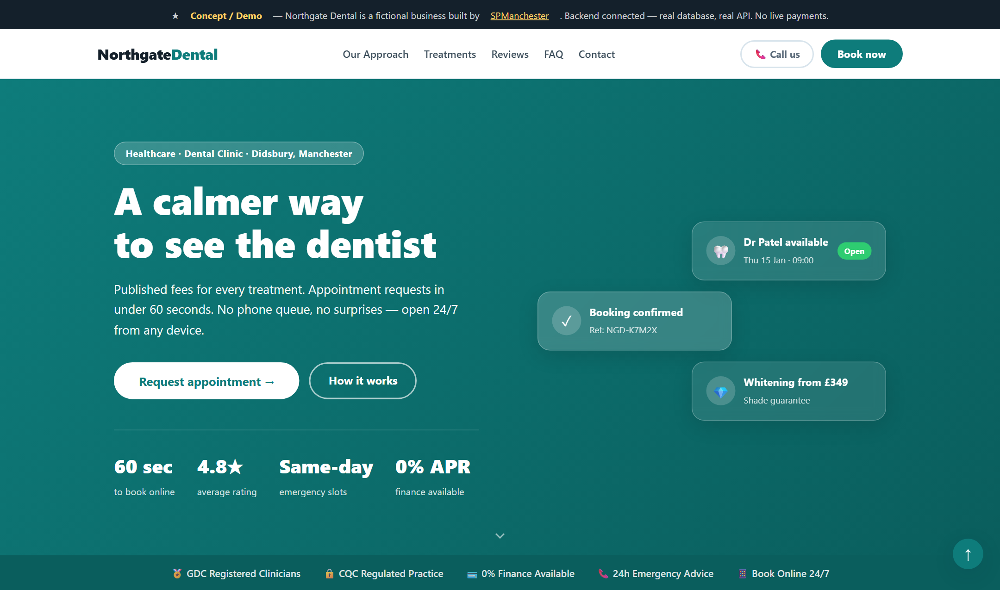](screenshots/01-frontend-hero.png) | [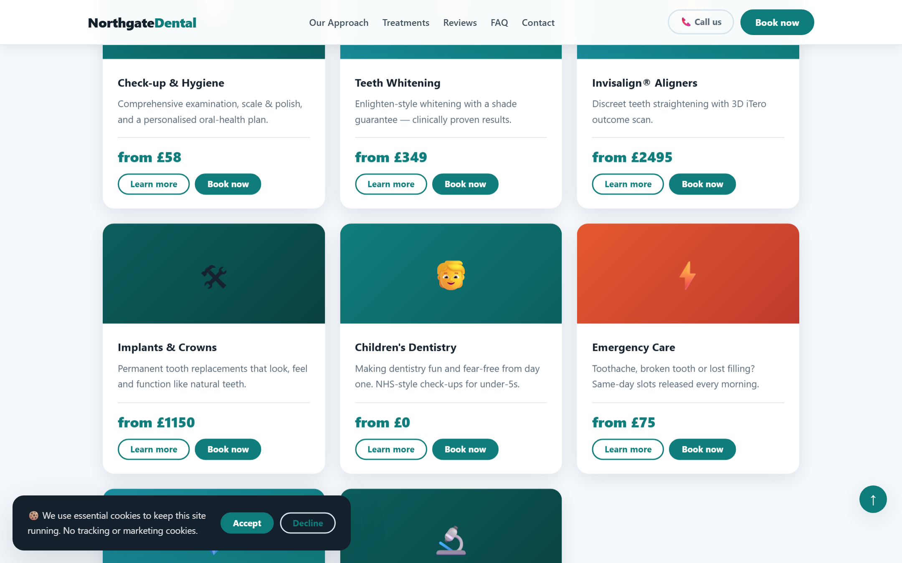](screenshots/03-frontend-treatments.png) |
| **3-Step Appointment Request Engine** | **Verified Reviews & Star Rating** |
| [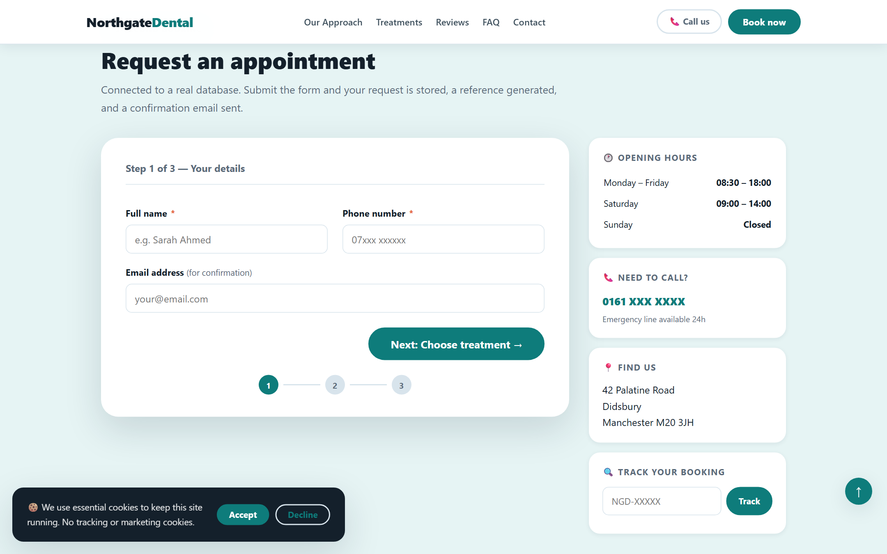](screenshots/04-frontend-booking.png) | [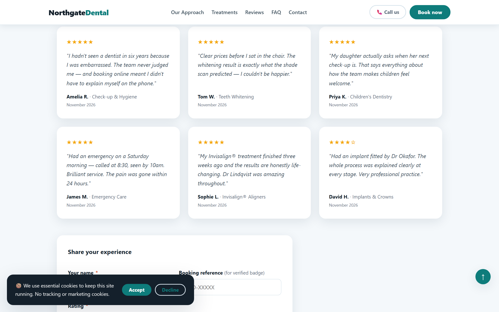](screenshots/05-frontend-reviews.png) |

### 🔒 Staff Management Portal (Backend)
| Dashboard Overview & Analytics | Appointment Triage & Management |
|:---:|:---:|
| [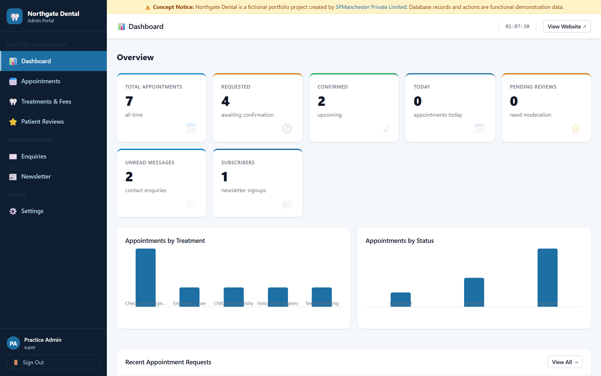](screenshots/09-admin-dashboard.png) | [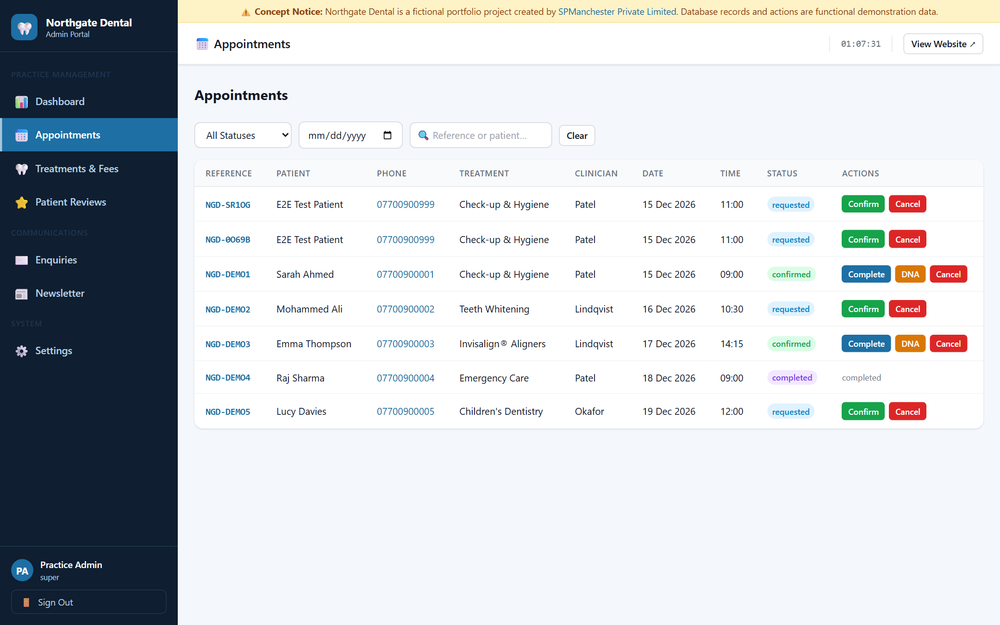](screenshots/10-admin-appointments.png) |
| **Slot Confirmation Modal** | **Inline Treatment Fee Editor** |
| [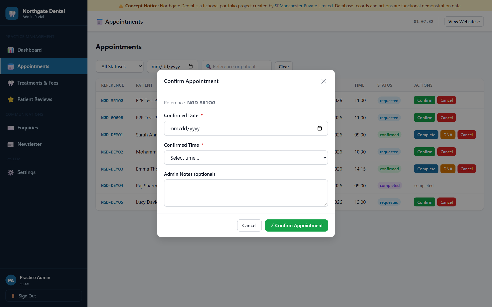](screenshots/11-admin-confirm-modal.png) | [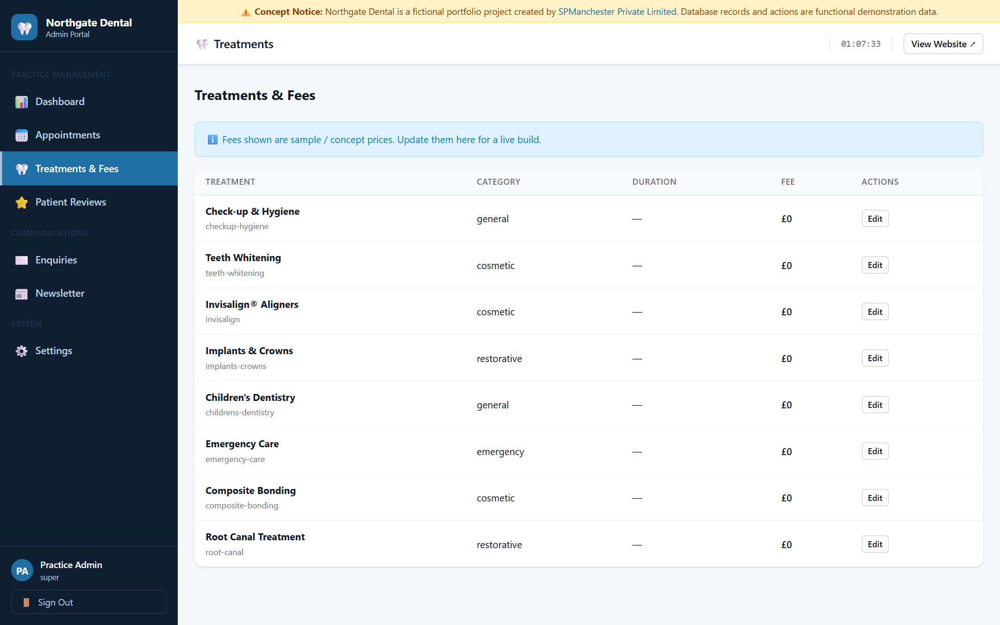](screenshots/12-admin-treatments.png) |
| **Patient Review Moderation** | **Mobile Responsive Admin View** |
| [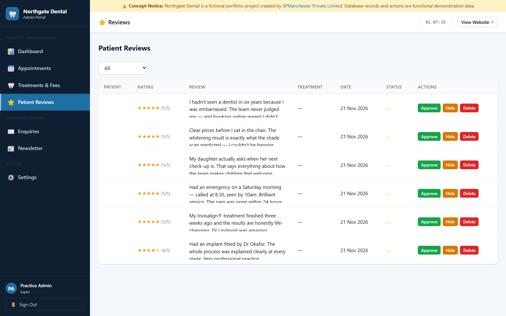](screenshots/13-admin-reviews.png) | [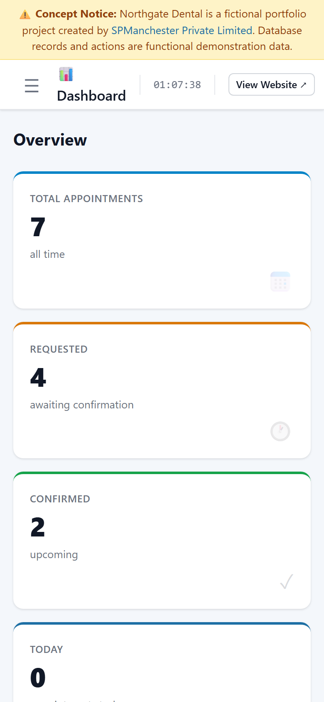](screenshots/17-admin-mobile-dashboard.png) |

> 📁 *Full-resolution captures of all 19 views (including full-page scroll and mobile drawers) are saved in the [`screenshots/`](screenshots/) directory.*

---

## 🌐 Live Demo

| Platform | URL |
|---|---|
| GitHub Pages | *Deploy in 2 minutes — instructions below* |
| Local (zero setup) | Open `src/index.html` in any browser |

### Try the Interactive Feature

```
1. Scroll to the "Request an appointment" section
2. Select a treatment  →  Check-up / Whitening / Invisalign® / etc.
3. Choose a clinician  →  First available / Dr Patel / Dr Okafor / Dr Lindqvist
4. Pick a date & time  →  Native date picker + 6 time slots
5. Enter name & phone  →  Required fields with native validation
6. Click "Request appointment"
7. ✅  Instant confirmation with a unique NGD-XXXXX booking reference
```

> Nothing is stored or transmitted — this is a fully client-side demo.

---

## 🎯 The Problem This Solves

Independent dental practices **lose patients at the phone**. The business case that drives every design decision on this site:

| Pain Point | Business Impact |
|---|---|
| 📞 Reception busy during peak hours | Calls go to voicemail; enquiries never converted |
| 💰 Fees hidden behind "call for a quote" | Anxious patients choose the transparent competitor |
| 🌙 No out-of-hours booking path | Busy parents can't book at 9pm from their phone |
| 📄 Website is a digital leaflet | No action, no conversion, no measurable ROI |

**This site answers all four** — with transparent pricing, trust-building content written for anxious patients, and a 60-second appointment request flow that works 24/7.

---

## ✨ Features

### 🏥 Core Patient Experience
- **Transparent Treatment Fees** — Every service has a published price. No *"POA"*, no surprises, no phone call needed to find a number
- **Gentle-Dentistry Copy** — Every sentence written for nervous and first-time patients, not for search engine bots
- **60-Second Appointment Request** — Treatment → clinician → date → time → instant reference. Timed in the brief
- **Mobile-First Design** — Fully usable one-handed at 360px width; tap targets ≥ 44px throughout

### 🛠 Technical Excellence
- **Zero Dependencies** — No npm, no bundler, no CDN. Opens from disk or any static host in seconds
- **Semantic HTML5** — Single H1, landmark regions (`<main>`, `<section>`, `<article>`), labelled inputs, ARIA-ready structure
- **CSS Custom Properties** — Full design token system; trivial to rebrand for a real client by editing `:root`
- **Progressive Enhancement** — All content (fees, FAQ, reviews) readable with JavaScript disabled

### 🔍 SEO & Trust
- **Local SEO** — Location keywords in headings; meta description targeting Didsbury/Manchester searches
- **Open Graph tags** — Social sharing preview for LinkedIn and Facebook
- **Problem → Solution Storytelling** — Narrative section written to resonate with practice owners as well as patients
- **Transparent Labelling** — Every sample figure clearly marked so the concept is never mistaken for a real booking site

---

## 🚀 Quick Start

### Prerequisites

| Tool | Required for |
|---|---|
| Node.js (v18+) | Full-stack server, REST API, SQLite database & Admin Dashboard |
| Any modern browser | Patient-facing website & Admin Portal |
| Python / npx (optional) | Static-only preview |

---

### Option 1 — Full-Stack Mode (Recommended — Backend + Database + Admin)

Experience the full application with live SQLite database, real-time availability, appointment booking, patient enquiry handling, and staff management portal:

```bash
# 1. Clone repository
git clone https://github.com/serviceprovidermanchester/spm-web-dental-clinic.git
cd spm-web-dental-clinic/backend

# 2. Install dependencies & initialize SQLite database
npm install
npm run setup

# 3. Start the server
npm start
```

Once running:
- 🌐 **Patient Website:** [http://localhost:3000/](http://localhost:3000/)
- 🔒 **Staff Admin Portal:** [http://localhost:3000/admin/](http://localhost:3000/admin/)
  - **Login:** `admin@northgatedental.co.uk`
  - **Password:** `Admin@NGD2026!`
- 🩺 **API Health Check:** [http://localhost:3000/api/health](http://localhost:3000/api/health)

---

### Option 2 — Open Locally (Zero Setup — Static Demo)

The front-end includes built-in offline fallbacks for portfolio and pitch demonstration:

```bash
# Open directly in browser — zero build step, zero dependencies:
# Windows:
start index.html

# macOS:
open index.html

# Linux:
xdg-open index.html
```

---

### Option 3 — Local Dev Server (Static Frontend)

```bash
# Using Python (available on most systems):
python -m http.server 8080 --directory src
# Then open: http://localhost:8080

# Using Node.js:
npx serve src
# Then open: http://localhost:3000

# Using VS Code:
# Install "Live Server" extension → right-click src/index.html → Open with Live Server (port 5500 automatically proxies API requests to localhost:3000)
```

---

### Option 4 — Deploy to GitHub Pages

```bash
# 1. Fork or push this repo to your GitHub account
# 2. Go to repo Settings → Pages
# 3. Source: "Deploy from a branch"
# 4. Branch: main / Branch folder: / (root)
# 5. Save — your site goes live at:
#    https://<your-username>.github.io/spm-web-dental-clinic/
```

---

### Option 5 — Deploy to Netlify / Vercel

```bash
# 1. Connect this GitHub repo to Netlify or Vercel
# 2. Build command:    (leave empty)
# 3. Publish directory: src (or root)
# 4. Click Deploy — live in seconds
```

---

### Syntax Validation

```bash
# Validate front-end scripts (Node.js required):
node --check src/script.js
node --check src/admin/admin.js

# Validate backend server & database:
node --check backend/server.js
node --check backend/database/db.js
node --check backend/database/seed.js
# → Expected output: (no output = clean syntax)
```

---

## 📐 Architecture

### Full-Stack Architecture (Node.js + Express + SQLite + Vanilla JS)

```
┌─────────────────────────────────────────────────────────────────────────┐
│                      Client Tier (Vanilla ES6+ UI)                     │
│  Zero build tools · Zero runtime libraries · High performance CSS3     │
│                                                                         │
│   ┌───────────────────────────────┐   ┌──────────────────────────────┐  │
│   │   Patient Website (src/)     │   │   Admin Portal (src/admin/)  │  │
│   │   • Multi-step Booking Form   │   │   • JWT Auth & Session Mgmt  │  │
│   │   • Real Availability Checker │   │   • Appointment Confirm/DNA  │  │
│   │   • Interactive Fee Explorer  │   │   • Dynamic Fee Editing      │  │
│   │   • Verified Reviews Display  │   │   • Review Moderation        │  │
│   │   • Contact & Newsletter      │   │   • Enquiries & CSV Export   │  │
│   └───────────────┬───────────────┘   └──────────────┬───────────────┘  │
└───────────────────┼──────────────────────────────────┼──────────────────┘
                    │ REST API / JSON                  │ Bearer JWT Auth
                    ▼                                  ▼
┌─────────────────────────────────────────────────────────────────────────┐
│                   Backend API Server (Node.js & Express)                │
│                                                                         │
│   • Security: Helmet headers, CORS policies, Rate Limiters              │
│   • Routing:  /api/appointments, /api/treatments, /api/clinicians,      │
│               /api/reviews, /api/contact, /api/auth, /api/admin,        │
│               /api/newsletter, /api/availability                        │
│   • Auth:     bcryptjs password hashing (12 rounds) + jsonwebtoken      │
│   • Comms:    Nodemailer (email receipts) + Twilio SMS notifications    │
└───────────────────────────────────┬─────────────────────────────────────┘
                                    │ SQL (better-sqlite3)
                                    ▼
┌─────────────────────────────────────────────────────────────────────────┐
│                      Database Tier (SQLite Embedded)                    │
│                                                                         │
│   • tables: appointments, clinicians, treatments, reviews, contacts,    │
│             newsletter_subscribers, admin_users, system_audit_log       │
│   • features: ACID compliance, foreign keys, indexed lookups, WAL mode  │
└─────────────────────────────────────────────────────────────────────────┘
```

### Visual Flow

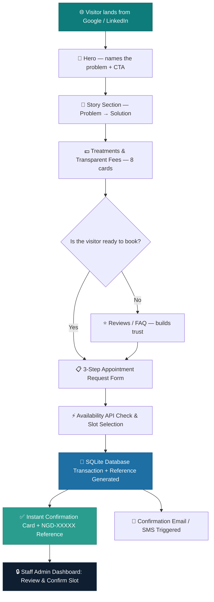

---

## 📁 Project Structure

```
spm-web-dental-clinic/
│
├── src/                              # 📂 Frontend source files
│   ├── index.html                    # Patient-facing website (semantic HTML5)
│   ├── styles.css                    # Master stylesheet (CSS variables, responsive)
│   ├── script.js                     # Patient frontend script (API client + offline fallback)
│   └── admin/                        # 📂 Staff management dashboard
│       ├── index.html                # Admin portal markup & authentication shell
│       ├── admin.css                 # Admin UI styling (tables, modals, stat cards)
│       └── admin.js                  # Admin single-page logic (JWT auth, CRUD, stats)
│
├── backend/                          # 📂 Full-stack backend API
│   ├── server.js                     # Express server & static asset pipeline
│   ├── package.json                  # Dependencies & start scripts
│   ├── database/                     # 📂 Database management
│   │   ├── db.js                     # SQLite connection pool & table setup
│   │   ├── schema.sql                # SQL schema (9 tables, indexes, constraints)
│   │   ├── seed.js                   # Seed script (clinicians, treatments, demo data)
│   │   └── setup.js                  # Standalone database init script
│   ├── middleware/                   # 📂 Express middleware
│   │   └── auth.js                   # JWT verification & role authorization
│   ├── routes/                       # 📂 Modular REST API routes
│   │   ├── admin.js                  # Stats overview & system management
│   │   ├── appointments.js           # Booking creation, tracking, confirmation
│   │   ├── auth.js                   # Staff login, session, password change
│   │   ├── availability.js           # Real-time slot availability engine
│   │   ├── clinicians.js             # Practice staff profiles
│   │   ├── contact.js                # Enquiry forms & message triage
│   │   ├── newsletter.js             # Subscriber signups & CSV export
│   │   ├── reviews.js                # Patient testimonials & moderation
│   │   └── treatments.js             # Treatment catalogue & fee updates
│   └── utils/                        # 📂 Utilities
│       ├── email.js                  # Nodemailer receipt delivery
│       ├── refCode.js                # Unique NGD-XXXXX reference generator
│       └── sms.js                    # SMS dispatch & notification templates
│
├── admin/                            # 📂 Root alias for admin portal (static hosting)
├── docs/                             # 📂 Project documentation
│   ├── API.md                        # Full REST API specification with JSON schemas
│   └── ACCESSIBILITY.md              # WCAG 2.2 AA compliance notes & checklist
│
├── screenshots/                      # 📂 Preview images for portfolio / GitHub
│   └── preview-homepage.png
│
├── .github/                          # 📂 GitHub configuration
│   ├── ISSUE_TEMPLATE/
│   │   ├── bug_report.md
│   │   └── feature_request.md
│   └── PULL_REQUEST_TEMPLATE.md
│
├── index.html                        # Root mirror for GitHub Pages & zero-setup preview
├── styles.css                        # Root styles mirror
├── script.js                         # Root script mirror
├── README.md                         # ← You are here
├── CONTRIBUTING.md                   # Contribution guidelines & commit conventions
├── CODE_OF_CONDUCT.md                # Community standards (Contributor Covenant 2.1)
├── SECURITY.md                       # Vulnerability reporting policy
├── CHANGELOG.md                      # Version history (Keep a Changelog format)
├── LICENSE                           # MIT Licence — © 2026 SPManchester Private Limited
├── .gitignore                        # Git ignore rules (node_modules, db, secrets)
├── .env.example                      # Production environment configuration guide
├── PRD.md                            # Product Requirements Document
└── TRD.md                            # Technical Requirements Document
```

---

## 💷 Treatment Fees (Sample Data)

> All fees are illustrative sample data for the Manchester market. A live build replaces these with the client's actual published prices.

| Treatment | Description | Sample Fee |
|---|---|---|
| 🦷 Check-up & hygiene | Examination, scale & polish, oral-health plan | from £58 |
| ✨ Teeth whitening | Enlighten-style whitening with shade guarantee | from £349 |
| 😁 Invisalign® aligners | Discreet straightening with 3D iTero outcome scan | from £2,495 |
| 🛠 Implants & crowns | Permanent replacements — natural look and feel | from £1,150 |
| 🧒 Children's dentistry | NHS-style check-ups for under-5s | Free* |
| ⚡ Emergency care | Same-day slots released every morning at 8:30am | from £75 |

---

## ⚙️ Interactive Logic Reference

The appointment-request form handler (from `src/script.js`):

```javascript
// Generic interceptor — wires any <form data-demo="handlerName">
document.querySelectorAll('form[data-demo]').forEach(function(form) {
  form.addEventListener('submit', function(e) {
    e.preventDefault();
    window[form.dataset.demo](new FormData(form));
  });
});

// Dental booking handler
window.bookDental = function(fd) {
  var ref = refCode('NGD'); // → e.g. "NGD-K7M2X"
  showResult('dental-result', /* confirmation HTML table */ );
};

// Reference generator: prefix + 5 random base-36 chars, upper-cased
function refCode(prefix) {
  return prefix + '-' + Math.random().toString(36).slice(2, 7).toUpperCase();
}
```

> **Security note:** The demo echoes user input into innerHTML — acceptable only for a local, self-only demo. The live build **must sanitise all user input** before DOM insertion. See [`SECURITY.md`](SECURITY.md) and TRD §7/S3.

---

## 🧪 Test Cases

All 8 test cases must pass before any release. Run `node --check src/script.js` for syntax validation.

| # | Test | Expected Result |
|---|---|---|
| **T01** | Submit complete appointment request | Confirmation panel shows treatment, clinician, date, time + `NGD-XXXXX` reference |
| **T02** | Submit with an empty required field | Browser blocks submission; no confirmation panel appears |
| **T03** | Open `src/index.html` with JavaScript disabled | All content (fees, FAQ, reviews) readable; form does not submit |
| **T04** | Resize viewport to 360px width | Nav, treatment cards and form stack without horizontal scrolling |
| **T05** | Click "Book appointment" in the sticky nav | Page smooth-scrolls to `#book` section |
| **T06** | View page source / DevTools | Exactly one `<h1>`; meta description present |
| **T07** | `node --check src/script.js` | Zero syntax errors reported |
| **T08** | Keyboard-only navigation (Tab key throughout) | All form fields and submit button reachable; focus visible on every element |

---

## 📊 Success Metrics (Live Build Targets)

| Metric | Target |
|---|---|
| Appointment-request submissions | ≥ 40 per month (baseline: phone-only) |
| Phone enquiries for routine bookings | −30% within 6 months of launch |
| Request-form completion rate | ≥ 60% of visitors who start the form |
| Time to complete a request | ≤ 60 seconds (median) |
| New-patient enquiries from organic search | +25% year on year (local SEO) |

---

## ♿ Non-Functional Requirements

| Area | Requirement |
|---|---|
| **Responsive** | Fully usable at 360px wide and on desktop; no horizontal scrolling; tap targets ≥ 44px |
| **Performance** | Static page, zero dependencies; live-build budget: LCP ≤ 2.5s, INP ≤ 200ms, CLS ≤ 0.1 (mid-range Android, 4G) |
| **Accessibility** | WCAG 2.2 AA target for live/public build; demo keeps semantic structure, labelled fields, `role="status"` on confirmation, visible focus |
| **SEO** | Single H1, meta description, Open Graph, location keywords; live build adds LocalBusiness JSON-LD and Google Business Profile alignment |
| **Security** | Live build: HTTPS/HSTS, input sanitisation, CSP, CSRF protection, rate limiting, Turnstile/hCaptcha spam protection |
| **Privacy** | Demo stores nothing; live build: UK GDPR privacy notice, lawful basis, diary-system DPA |

---

## 🗺 Roadmap

### ✅ v1.0 — Concept (Current — Nov 2026)
- [x] Mobile-first responsive design (360px → desktop)
- [x] Transparent fee cards for all 6 treatments
- [x] Working appointment request form with instant `NGD-XXXXX` confirmation
- [x] Problem → Solution storytelling section
- [x] Sample reviews and 6-question FAQ sections
- [x] Local SEO structure (semantic HTML, meta, Open Graph, location keywords)
- [x] Zero dependencies — opens from disk or any static host
- [x] ARIA `role="status"` live region on confirmation panel
- [x] Date input auto-sets minimum to today
- [x] Full documentation suite (PRD, TRD, API, Accessibility)

### 🎨 v1.1 — Visual Upgrade (Backlog Priority 1)
> *From Ali's review, 10 November 2026 — the designs work but are not special enough yet.*
- [ ] Real photography / licensed imagery replacing CSS gradient placeholders
- [ ] Premium hero with animation-on-scroll (`IntersectionObserver`)
- [ ] Distinctive typography system (custom font pairing via `@font-face`)
- [ ] Hamburger / drawer mobile navigation
- [ ] Additional screenshots (mobile viewport + key-feature states)

### 🚀 v2.0 — Live MVP (Client Build)
- [ ] `POST /api/appointment-requests` → Dentally / Software of Excellence diary
- [ ] `GET /api/availability` → real available slots replace static options
- [ ] SMS confirmation via Twilio on submission + 24h reminder
- [ ] Verified Google Reviews replacing sample testimonials
- [ ] GA4 events: form_start, form_submit, confirmation_shown, cta_click, phone_click
- [ ] Privacy notice, UK GDPR lawful basis, diary-system DPA
- [ ] Input sanitisation, CSRF, rate limiting, Turnstile spam protection

### 🌟 v3.0 — Enhanced (Future)
- [ ] Online check-in and medical history forms
- [ ] Treatment plan acceptance + finance / deposit payments (hosted PCI page)
- [ ] Multi-clinician availability calendar view
- [ ] Patient portal (appointment history, recalls)

---

## 🌐 Production API Contract (Live Build Reference)

| Endpoint | Purpose |
|---|---|
| `POST /api/appointment-requests` | Create a request `{name, phone, treatmentId, clinicianId, date, time, notes}` → `201 {reference, status: 'requested'}` |
| `GET /api/availability?clinicianId=&date=` | Return bookable slots from the practice diary |
| `POST /api/appointment-requests/{reference}/confirm` | Practice-side confirmation; triggers SMS to the patient |

> See [`docs/API.md`](docs/API.md) for the full contract with request/response schemas and error codes.

---

## 🤝 Contributing

Contributions are welcome! This is an open portfolio project — improvements help the whole community.

```bash
# 1. Fork the repo on GitHub
# 2. Clone your fork
git clone https://github.com/YOUR_USERNAME/spm-web-dental-clinic.git

# 3. Create a feature branch
git checkout -b feat/your-feature-name

# 4. Make your changes — no build step needed

# 5. Validate syntax
node --check src/script.js

# 6. Commit (Conventional Commits format)
git commit -m "feat(form): add scroll-triggered confirmation reveal animation"

# 7. Push and open a PR
git push origin feat/your-feature-name
```

Please read [**CONTRIBUTING.md**](CONTRIBUTING.md) for commit conventions, the full PR checklist, coding standards, and issue templates.

---

## 🔐 Security

Found a vulnerability? Please disclose it responsibly — **do not open a public issue.**

👉 See [**SECURITY.md**](SECURITY.md) for the full reporting process and response timelines.

**Known demo limitations documented in TRD §7:**
- User input echoed into HTML without sanitisation (demo-only — must fix for production)
- No CSRF protection, rate limiting, or server-side validation (required in live build)

---

## 📄 License

```
MIT License
Copyright (c) 2026 SPManchester Private Limited
https://spmanchester.com/
```

This project is open source under the **MIT Licence** — see [LICENSE](LICENSE) for the full text.

---

## 🏢 About SPManchester Private Limited

<div align="center">

**[SPManchester](https://spmanchester.com/)** is a Manchester-based web design and development studio building high-performance, conversion-focused websites for UK SMEs and professional services firms.

| | |
|---|---|
| 🌐 **Website** | [spmanchester.com](https://spmanchester.com/) |
| 📧 **Email** | [info@spmanchester.com](mailto:info@spmanchester.com) |
| 💼 **LinkedIn** | [linkedin.com/company/spmanchester](https://www.linkedin.com/company/spmanchester) |
| 🐙 **GitHub** | [github.com/serviceprovidermanchester](https://github.com/serviceprovidermanchester) |
| 📍 **Location** | Manchester, United Kingdom |

</div>

### Our Portfolio — Web Design & Development (10 Concept Sites)

This project is **01** in a series of 10 concept websites demonstrating our capability across UK service sectors:

| # | Project | Interactive Feature |
|---|---|---|
| **01** | **Northgate Dental** *(this repo)* | 60-second appointment request with instant NGD-XXXXX reference |
| 02 | Saffron & Sage Restaurant | Tabbed menus + commission-free table booking in 30 seconds |
| 03 | Peak Physio | Condition finder → matched treatment + booking |
| 04 | Hartley & Co Solicitors | Fixed-fee estimator + confidential consultation request |
| 05 | IronWorks Gym | Data-driven timetable (18 classes) + online joining flow |
| 06 | Lens & Light Photography | Filterable gallery + build-your-own package estimator |
| 07 | Elmwood Primary School | News/term-dates hub + online absence reporting |
| 08 | RapidFlow Plumbing | Interactive quote calculator + 24/7 lead capture |
| 09 | Keystone Estates | Searchable property listings (8 homes) + valuation funnel |
| 10 | BrightStart Youth Trust | Donation widget with impact translation + Gift Aid toggle |

👉 **Full portfolio at [spmanchester.com/projects](https://spmanchester.com/projects)**

---

## 🙏 Acknowledgements

- **Author & maintainer:** Sayed Mudassar Akbar — [SPManchester Private Limited](https://spmanchester.com/)
- **Concept review:** Ali, SPManchester — 10 November 2026
- **Inspiration:** The 40,000+ independent dental practices in the UK whose patients never book because the website is a digital leaflet

---

## 📌 GitHub Topics (for discoverability)

> When publishing, add these topics to the repository Settings → Topics:

```
html css javascript dental-website booking-system
manchester web-design portfolio-project static-site
appointment-booking healthcare-website mobile-first
frontend vanilla-js open-source spmanchester
```

---

<div align="center">

*Made in Manchester 🐝 — where patients deserve better than a phone queue*

**[⭐ Star this repo](https://github.com/serviceprovidermanchester/spm-web-dental-clinic)** to support open-source portfolio work from SPManchester.

<br/>

[spmanchester.com](https://spmanchester.com/) &nbsp;·&nbsp; [info@spmanchester.com](mailto:info@spmanchester.com) &nbsp;·&nbsp; [LinkedIn](https://www.linkedin.com/company/spmanchester) &nbsp;·&nbsp; [GitHub](https://github.com/serviceprovidermanchester)

</div>
